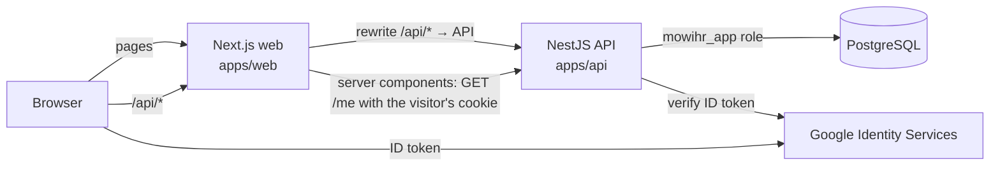

# MowiHR — Architecture

Last updated: Oct 20, 2026

MowiHR is a pnpm monorepo with a Next.js web app, a NestJS REST API and one PostgreSQL database. The browser only ever talks to the web app's origin; the web app proxies `/api/*` to the API, so the session cookie is first-party.

## Layout

| Path | What it holds |
| --- | --- |
| `apps/api` | NestJS 12 API (ESM). Drizzle ORM over `pg`. Tests run against a real Postgres. |
| `apps/api/drizzle` | SQL migrations. `0000_init` is generated from `src/db/schema.ts`; `0001_data_protections` is hand-written (triggers and grants). |
| `apps/web` | Next.js 16 App Router, next-intl for ES/PT/EN. |
| `packages/shared` | Types and constants both apps use: roles, locales, the locale cookie name. |

## Sign-in and sessions

1. The login page renders the Google Identity Services button, limited to Mowi's Workspace domain (`hd`).
2. Google returns an ID token to the browser, which posts it to `POST /api/auth/google`.
3. The API verifies the token's signature and audience with `google-auth-library`, then requires `email_verified`, `hd` equal to `GOOGLE_WORKSPACE_DOMAIN` **and** an address ending in `@<domain>`.
4. The address must belong to a live, active employee. Nobody is created on first sign-in: HR adds people.
5. The API creates a server-side session: a random 256-bit token goes in the `mowihr_session` cookie (httpOnly, SameSite=Lax, Secure outside development/test); only its SHA-256 is stored.
6. Every request resolves the cookie to the person and their roles. Expired or revoked sessions, deactivated people and removed roles stop working on the next request.

Every refused sign-in returns the same message. Refusals for real Google accounts are audited; outsiders are recorded by domain only. Sign-in is rate-limited per client address (`SIGN_IN_ATTEMPTS_PER_5_MIN`, in-memory, per instance).

`POST /auth/dev-login` signs in by email without Google. It exists only when `DEV_LOGIN_ENABLED=true` **and** `NODE_ENV` is `development` or `test`; the API refuses to start otherwise.

**CSRF:** SameSite=Lax cookies, plus the API refuses any write whose `Origin` header is not `WEB_ORIGIN`.

## Roles and authorization

- Every active person has the implicit `employee` role. Other roles live in `role_assignments`: `hr`, `super_admin`, and the area-scoped `area_leader` and `board_approver` (which only count while their area is active).
- A global guard requires a session on every endpoint unless it is marked `@Public()`. `@RequireRoles(...)` adds a role check; `super_admin` passes every role check.
- Checks that depend on the record (for example "a board approver of *this* area", "not your own request") belong in the service, not the decorator.
- `super_admin` cannot be granted through the API (only the seed script sets it), and nobody can change their own roles.

## Data principles in the database

The spec's rules are enforced by Postgres, not only by app code:

- **The app connects as `mowihr_app`**, which has `SELECT, INSERT, UPDATE` on tables that change, `SELECT, INSERT` on `audit_log`, and nothing else. Tables created later default to `SELECT, INSERT`; UPDATE is granted table by table.
- **Delete and truncate triggers** on every table raise an error even for the owner role. A test fails if a table is missing them.
- **`audit_log` is append-only**: no UPDATE privilege, plus a trigger.
- **Soft delete:** business tables carry `deleted_at`/`deleted_by`. Reads use `live(table, ...)` / `notDeleted(table)` from `src/db/soft-delete.ts`; removals use `softDelete()`. Unique keys are partial indexes over live rows, so a removed record does not block re-creating it.

## Audit log

`AuditService.record(entry, tx)` writes who (actor), what (action, entity, before/after JSON), when, and from where (IP, user agent, request id). Pass the transaction that makes the change, so both commit or roll back together. The actor and client details come from the request context (`AsyncLocalStorage`, set by `RequestContextMiddleware`).

Logged today: sign-in, refused sign-in, sign-out, role grants and removals, preference changes, and seed data. Every new write endpoint must add its own entry.

## Languages

The web app renders in the language in the `mowihr_locale` cookie (Spanish if missing). The API sets that cookie from the profile at sign-in and clears it at sign-out; changing the language saves it on the profile (`PATCH /me/preferences`) and updates the cookie. Catalogs are `apps/web/messages/{es,pt,en}.json`; a test keeps their keys identical.

## Conventions for new modules

- Validate input with `ZodValidationPipe` and a `.strict()` schema.
- Write in a transaction: lock the row (`.for('update')`), change it, record the audit entry with `before` and `after`.
- Never call `.delete()`; ESLint blocks `db.delete` and `tx.delete`.
- New tables: add delete/truncate triggers and explicit grants in a migration; the protection tests will tell you if you forgot.
- Integration tests go in `apps/api/test` and use `createTestApp()` from `test/helpers.ts` (a fake Google verifier and a fresh `mowihr_test` database).
