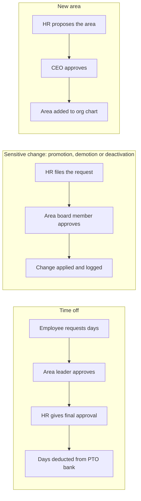

# MowiHR — v1 Product Spec

Last updated: Oct 20, 2026 · Horencio Alei Ruiz Mata

## Overview

MowiHR is an internal web app that gives every Mowi employee one place for their profile, payments, time off, the org chart and company announcements, replacing WhatsApp and spreadsheets for HR.

Mowi is based in Uruguay with staff distributed across South America. Today HR, payments and announcements run through WhatsApp groups, spreadsheets and crypto transfers, with no single record of who works where, what they were paid or what changed.

**Goals for v1**

- One employee directory and org chart that HR owns and everyone can see
- Sensitive account changes (promotions, demotions, deactivations) only take effect after board approval
- Every employee can see their own payment history and remaining time-off days
- Company announcements move out of WhatsApp into a feed HR controls
- A complete, permanent history of every change: nothing is ever hard-deleted

**Not in v1**

- Processing payments: MowiHR only records payments made elsewhere
- Payroll calculation, taxes or country-specific labor compliance
- Performance reviews, recruiting, or a native mobile app

## Roles and permissions

Five roles, each adding to the one before; a person can hold more than one (an area leader can also be a board approver).

| Role | Who | Can do |
| --- | --- | --- |
| Employee | Everyone at Mowi | See directory, org chart, feed; comment and react; edit own contact info; see own payments and PTO balance; request time off; see holidays for every country |
| Area leader | Head of each team | Everything an employee can, plus approve or reject time-off requests from their team (first step) |
| HR | HR staff | Add employees; edit records; record payments (manual or spreadsheet import); post announcements; manage holidays per country; give final time-off approval; *request* promotions, demotions, deactivations and new areas |
| Board approver | Members of the board of directors | Approve or reject sensitive requests for employees in their own area |
| Super admin | CEO only | Everything, including approving board members' own requests and new areas |

**Rules that hold for every role**

- Nobody approves a request about themselves; a board member's own sensitive request goes to the CEO.
- Super admin actions are logged like anyone else's and cannot bypass the audit trail.
- Testing happens in a staging environment with fake data, not with a super admin account in production.

## Approval workflows

Three kinds of request need approval before they take effect; adding an employee does not.

A rejection at any step ends the request; every step is logged. A board member's own change goes to the CEO instead.

A request is pending until every step approves; the requester and approvers get an email at each step, and a rejection must include a reason.

## Modules

v1 has seven modules; every screen works on a phone, since staff will often check it there.

### 1. Directory and org chart

- Searchable list of active employees: name, photo, role, area, leader, country
- Org chart (organigrama) built from each employee's area and leader
- Areas are created by HR and take effect after CEO approval

### 2. Profile and contact info

- Each employee edits their own contact fields: corporate email, WhatsApp number, Slack handle (optional), personal email, phone
- HR-owned fields are read-only for the employee: role, area, leader, start date, status
- Every edit is versioned, so previous values remain visible to HR

### 3. Community feed

- Only HR can publish announcements
- Everyone can comment and react
- Optional pinned posts for important notices; employees get an email for new announcements

### 4. Time off

- Each employee has a PTO bank: days granted, days used, days pending, days left
- A request goes to the employee's area leader first, then HR for final approval
- Approved days are deducted from the bank; rejected or cancelled requests return them
- HR can adjust balances, with a required reason

### 5. Payment records

MowiHR records payments made elsewhere; it never moves money.

- Fields per record: employee, date, amount, currency (fiat or crypto), method, period covered, optional transaction hash, optional receipt screenshot
- HR adds records one at a time, or in bulk by uploading a spreadsheet (CSV or XLSX) with a preview and error check before saving
- Each employee sees only their own deposit history
- Corrections create a new version of the record; the original stays in the history

### 6. Requests and approvals inbox

- One inbox per person showing what they need to approve: time off, sensitive account changes, new areas
- Each request shows who asked, why, and its full history; approvers are notified by email

### 7. Holidays per country

- A calendar of public holidays for each country where Mowi has staff (Uruguay, Paraguay, Argentina, Brazil and any added later)
- Everyone can see every country's holidays; each person sees their own country's first
- Only HR and the CEO can add, edit or remove holidays; removals are logical, like everything else
- Time-off requests skip the holidays of the employee's country when counting working days

## Data principles

Nothing in MowiHR is ever hard-deleted: every removal is a logical delete, and every change is recorded.

- **Soft delete everywhere.** Records carry `deleted_at` and `deleted_by` columns; default queries filter them out. No `DELETE`, `DROP` or `TRUNCATE` in application code, and the app's database user has no permission to run them.
- **Deactivation, not removal.** A deactivated employee loses access but keeps their record, payments and history.
- **Append-only audit log.** Every create, update, soft delete, approval, rejection, login and data export is written with who, when, what changed (before and after) and from where. The log table is insert-only.
- **Versioned records.** Edits to profiles and payment records create a new version instead of overwriting.
- **Access by role.** Payment and personal data are visible only to the person themselves, HR and the super admin.
- **Files stored privately.** Receipt screenshots and imports live in a private bucket, served through short-lived signed links.

**Privacy note:** Uruguay and Brazil both have personal data laws that can give people the right to have their data erased. Before launch, confirm with Mowi's legal advisor how a valid erasure request is handled; the likely answer is anonymizing personal fields while keeping the audit trail.

## Technical approach

MowiHR reuses Mowi's existing AWS setup and TypeScript stack.

| Area | Choice |
| --- | --- |
| Frontend | Next.js (responsive web, no native app) |
| Backend | NestJS REST API with role-based guards on every endpoint |
| Database | PostgreSQL (recommended over MySQL for its JSON support in the audit log and row-level security options) |
| Sign-in | Google Workspace only, restricted to Mowi's domain; no passwords stored |
| Files | Private S3 bucket for receipt screenshots and spreadsheet imports |
| Email | Amazon SES for approval requests, decisions and new announcements |
| Languages | Spanish, Portuguese and English; each user picks theirs, Spanish by default |
| Environments | Separate staging (fake data, used for testing) and production |

**Build order**

1. Sign-in, roles, employees, areas, audit log and soft delete (the foundation everything else depends on)
2. Directory, org chart and profile editing
3. Approval engine: sensitive changes and new areas
4. Time off with PTO bank and holidays per country
5. Payment records and spreadsheet import
6. Community feed with comments and reactions

## Open questions and assumptions

**Assumptions made in this spec** (change any that are wrong)

- Time off needs both approvals: area leader first, then HR.
- Each area has exactly one board approver; if that person is unavailable, the CEO can approve.
- Payment amounts are recorded in the currency actually paid, with no conversion.
- Employees with no area leader send time-off requests straight to HR.

**Still to decide**

- [ ] PTO rules: how many days per employee, per country or per contract, and do unused days roll over?
- [ ] Should HR adding a new employee also need any approval, or stay HR-only?
- [ ] Do approvals expire if nobody acts within a set number of days?
- [ ] Spreadsheet import: share one current payment spreadsheet to define the template.
- [ ] Erasure requests under Uruguayan and Brazilian data law: confirm the handling with legal.
- [ ] Rough headcount and number of areas, to size the first rollout.
