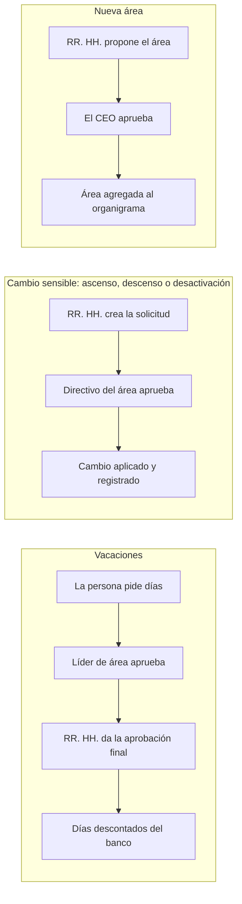

# MowiHR — Especificación v1

Última actualización: 20 oct 2026 · Horencio Alei Ruiz Mata

## Resumen

MowiHR es una aplicación web interna que da a cada persona de Mowi un solo lugar para su perfil, pagos, vacaciones, el organigrama y los anuncios de la empresa, reemplazando WhatsApp y las hojas de cálculo en lo relacionado con RR. HH.

Mowi tiene sede en Uruguay y su equipo está distribuido por Sudamérica. Hoy RR. HH., pagos y anuncios pasan por grupos de WhatsApp.

**Objetivos de la v1**

- Un directorio y organigrama que RR. HH. administra y que todos pueden ver
- Los cambios sensibles (ascensos, descensos, desactivaciones) solo se aplican con aprobación del directorio
- Cada persona ve su historial de pagos y los días de vacaciones que le quedan
- Los anuncios salen de WhatsApp y pasan a un muro que controla RR. HH.
- Un historial completo y permanente de cada cambio: nada se borra físicamente

**Fuera de la v1**

- Procesar pagos: MowiHR solo registra pagos hechos en otro lugar
- Cálculo de nómina, impuestos o cumplimiento laboral por país
- Evaluaciones de desempeño, reclutamiento o una app móvil nativa

## Roles y permisos

Cinco roles, cada uno suma permisos al anterior; una persona puede tener más de uno (un líder de área también puede ser aprobador del directorio).

| Rol | Quién | Puede |
| --- | --- | --- |
| Colaborador | Todas las personas de Mowi | Ver directorio, organigrama y muro; comentar y reaccionar; editar su información de contacto; ver sus pagos y saldo de vacaciones; solicitar vacaciones; ver los feriados de cada país |
| Líder de área | Responsable de cada equipo | Todo lo anterior, más aprobar o rechazar las vacaciones de su equipo (primer paso) |
| RR. HH. | Equipo de RR. HH. | Dar de alta personas; editar fichas; registrar pagos (manual o por hoja de cálculo); publicar anuncios; administrar los feriados por país; dar la aprobación final de vacaciones; *solicitar* ascensos, descensos, desactivaciones y nuevas áreas |
| Aprobador del directorio | Miembros del directorio | Aprobar o rechazar solicitudes sensibles de personas de su propia área |
| Superadministrador | Solo el CEO | Todo, incluida la aprobación de solicitudes de miembros del directorio y de nuevas áreas |

**Reglas para todos los roles**

- Nadie aprueba una solicitud sobre sí mismo; las solicitudes sensibles de un miembro del directorio van al CEO.
- Las acciones del superadministrador se registran como las de cualquiera y no pueden saltarse la auditoría.
- Las pruebas se hacen en un entorno de staging con datos ficticios, no con una cuenta de superadministrador en producción.

## Flujos de aprobación

Tres tipos de solicitud necesitan aprobación antes de aplicarse; dar de alta a una persona no.

Un rechazo en cualquier paso termina la solicitud; cada paso queda registrado. Si el cambio es de un miembro del directorio, aprueba el CEO.

Una solicitud queda pendiente hasta que cada paso la aprueba; quien la pide y quienes aprueban reciben un correo en cada paso, y todo rechazo debe incluir un motivo.

## Módulos

La v1 tiene siete módulos; todas las pantallas funcionan en el celular, porque el equipo las revisará seguido desde ahí.

### 1. Directorio y organigrama

- Lista buscable de personas activas: nombre, foto, puesto, área, líder, país
- Organigrama construido a partir del área y el líder de cada persona
- RR. HH. crea las áreas y estas se activan con la aprobación del CEO

### 2. Perfil e información de contacto

- Cada persona edita sus datos de contacto: correo corporativo, número de WhatsApp, usuario de Slack (opcional), correo personal, teléfono
- Los campos de RR. HH. son de solo lectura para la persona: puesto, área, líder, fecha de ingreso, estado
- Cada edición se versiona, así RR. HH. puede ver los valores anteriores

### 3. Muro de la comunidad

- Solo RR. HH. puede publicar anuncios
- Todos pueden comentar y reaccionar
- Publicaciones fijadas para avisos importantes; se envía un correo por cada anuncio nuevo

### 4. Vacaciones

- Cada persona tiene un banco de días: otorgados, usados, pendientes y disponibles
- La solicitud va primero al líder de área y después a RR. HH. para la aprobación final
- Los días aprobados se descuentan del banco; las solicitudes rechazadas o canceladas los devuelven
- RR. HH. puede ajustar saldos indicando siempre un motivo

### 5. Registro de pagos

MowiHR registra pagos hechos en otro lugar; nunca mueve dinero.

- Campos por registro: persona, fecha, monto, moneda (fiat o cripto), método, periodo cubierto, hash de transacción opcional, captura de pantalla del comprobante opcional
- RR. HH. agrega registros uno por uno o en lote subiendo una hoja de cálculo (CSV o XLSX), con vista previa y validación antes de guardar
- Cada persona solo ve su propio historial de depósitos
- Las correcciones crean una nueva versión del registro; el original queda en el historial

### 6. Bandeja de solicitudes y aprobaciones

- Una bandeja por persona con lo que tiene pendiente de aprobar: vacaciones, cambios sensibles, nuevas áreas
- Cada solicitud muestra quién la pidió, por qué y su historial completo; los aprobadores reciben aviso por correo

### 7. Feriados por país

- Calendario de feriados de cada país donde Mowi tiene personal (Uruguay, Paraguay, Argentina, Brasil y los que se sumen)
- Todos pueden ver los feriados de todos los países; cada persona ve primero los de su país
- Solo RR. HH. y el CEO pueden agregar, editar o quitar feriados; quitar es un borrado lógico, como todo lo demás
- Al contar los días hábiles de una solicitud de vacaciones se excluyen los feriados del país de la persona

## Principios de datos

En MowiHR nada se borra físicamente: toda eliminación es lógica y todo cambio queda registrado.

- **Borrado lógico en todo.** Los registros llevan columnas `deleted_at` y `deleted_by`; las consultas por defecto los excluyen. El código nunca usa `DELETE`, `DROP` ni `TRUNCATE`, y el usuario de base de datos de la app no tiene permiso para ejecutarlos.
- **Desactivar, no eliminar.** Una persona desactivada pierde el acceso pero conserva su ficha, pagos e historial.
- **Bitácora de auditoría solo de inserción.** Cada alta, edición, borrado lógico, aprobación, rechazo, inicio de sesión y exportación se guarda con quién, cuándo, qué cambió (antes y después) y desde dónde.
- **Registros versionados.** Las ediciones de perfiles y pagos crean una nueva versión en lugar de sobrescribir.
- **Acceso por rol.** Los datos personales y de pagos solo los ven la propia persona, RR. HH. y el superadministrador.
- **Archivos privados.** Las capturas de comprobantes y las importaciones se guardan en un bucket privado y se sirven con enlaces firmados de corta duración.

**Nota de privacidad:** Uruguay y Brasil tienen leyes de datos personales que pueden dar derecho a pedir que se eliminen los datos. Antes del lanzamiento, confirmar con el asesor legal de Mowi cómo atender una solicitud válida; lo más probable es anonimizar los campos personales y conservar la auditoría.

## Enfoque técnico

MowiHR reutiliza la infraestructura actual de Mowi en AWS y su stack en TypeScript.

| Área | Elección |
| --- | --- |
| Frontend | Next.js (web adaptable al celular, sin app nativa) |
| Backend | API REST en NestJS con control por rol en cada endpoint |
| Base de datos | PostgreSQL (recomendado sobre MySQL por su soporte JSON para la auditoría y la seguridad a nivel de fila) |
| Acceso | Solo con Google Workspace, restringido al dominio de Mowi; no se guardan contraseñas |
| Archivos | Bucket privado de S3 para comprobantes e importaciones |
| Correo | Amazon SES para solicitudes, decisiones y anuncios nuevos |
| Idiomas | Español, portugués e inglés; cada persona elige el suyo, español por defecto |
| Entornos | Staging (datos ficticios, para pruebas) y producción separados |

**Orden de construcción**

1. Acceso, roles, personas, áreas, auditoría y borrado lógico (la base de todo lo demás)
2. Directorio, organigrama y edición de perfil
3. Motor de aprobaciones: cambios sensibles y nuevas áreas
4. Vacaciones con banco de días y feriados por país
5. Registro de pagos e importación por hoja de cálculo
6. Muro de la comunidad con comentarios y reacciones

## Preguntas abiertas y supuestos

**Supuestos de esta especificación** (cambien los que no sean correctos)

- Las vacaciones necesitan ambas aprobaciones: primero el líder de área, después RR. HH.
- Cada área tiene un solo aprobador del directorio; si no está disponible, puede aprobar el CEO.
- Los montos se registran en la moneda en que se pagaron, sin conversión.
- Las personas sin líder de área envían sus solicitudes de vacaciones directo a RR. HH.

**Por decidir**

- [ ] Reglas de vacaciones: cuántos días por persona, por país o por contrato, y si los días no usados se acumulan.
- [ ] ¿Dar de alta a una persona también requiere aprobación, o queda solo en manos de RR. HH.?
- [ ] ¿Las aprobaciones vencen si nadie responde en cierto número de días?
- [ ] Importación de pagos: compartir una hoja de cálculo actual para definir la plantilla.
- [ ] Solicitudes de eliminación bajo las leyes de datos de Uruguay y Brasil: confirmar el procedimiento con legal.
- [ ] Número aproximado de personas y áreas, para dimensionar el primer despliegue.
