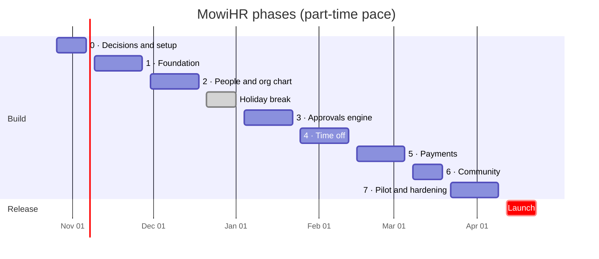

# MowiHR — Work Plan

Last updated: Oct 20, 2026 · Horencio Alei Ruiz Mata

MowiHR ships in eight phases over about six months, with a pilot in March and company-wide launch the week of Apr 12, 2027.

## Timeline

Phases run back to back; the holiday break absorbs slips from the first three phases before the approvals work starts in January.

## Phases

The plan assumes one developer working part-time (about 15–20 hours a week) with AI assistance; full-time work would roughly halve it. Each phase ends with a demo on staging, and the next one starts only when its done-when criteria are met.

| Phase | Dates | Deliverables | Done when |
| --- | --- | --- | --- |
| 0. Decisions and setup | Oct 26 – Nov 6 | Open questions closed (PTO rules, approval expiry, headcount); spec and design signed off; AWS, Google Workspace sign-in client and domain ready | CEO signs off the spec and the payment spreadsheet template is agreed |
| 1. Foundation | Nov 9 – Nov 27 | Next.js + NestJS project; PostgreSQL schema with soft delete and audit log; Google sign-in limited to Mowi's domain; roles; ES/PT/EN setup; staging and deploys | A staging user can sign in, gets the right role, and every change shows in the audit log |
| 2. People and org chart | Nov 30 – Dec 18 | Employees and areas; directory; org chart; profile editing with version history; HR adds people | HR can load all current staff and the org chart matches reality |
| Holiday break | Dec 21 – Jan 1 | Buffer for slips | — |
| 3. Approvals engine | Jan 4 – Jan 22 | Request and approval model; promotions, demotions, deactivations, new areas; inbox; email notices | A sensitive change only applies after the right approver, and nobody approves their own |
| 4. Time off | Jan 25 – Feb 12 | PTO bank; holidays per country (everyone sees them, only HR and the CEO add them); leader then HR approval; balance adjustments with reason | Balances stay correct across approve, reject and cancel, and day counts skip each country's holidays |
| 5. Payments | Feb 15 – Mar 5 | Manual entry; CSV/XLSX import with preview; receipt screenshots in private storage; corrections as new versions | Last three months of payments imported and each employee sees only their own |
| 6. Community | Mar 8 – Mar 19 | HR-only posts; comments; reactions; pinned posts; email on new posts | HR publishes the first real announcement on staging |
| 7. Pilot and hardening | Mar 22 – Apr 9 | Security review; mobile and accessibility checks; Portuguese and English copy; pilot with HR and one area | Pilot users run a full month-end (time off, payments, posts) without WhatsApp |
| Launch | Apr 12 – Apr 23 | Rollout to everyone; short training; announcements move off WhatsApp | Every active employee has signed in at least once |

## Who does what

The developer builds; Mowi's people decide, test and adopt. Most delays in internal tools come from waiting on decisions, so each one has an owner and a deadline.

| Role | Responsibilities | Time needed |
| --- | --- | --- |
| Developer (Horencio) | Build, deploy and maintain; weekly demo on staging | 15–20 h/week |
| HR lead | Defines PTO rules and the payment template; loads each country's holidays; loads staff data; runs the pilot | 2–3 h/week, more during pilot |
| CEO | Signs off spec and design; approves areas; final say on launch | 1 h every two weeks |
| Board members | Test the approvals inbox for their area | 1 h in phase 3 and pilot |
| Legal advisor | Confirms data-erasure handling for Uruguay and Brazil | One review before pilot |

**Decisions needed before Nov 6**

- PTO days per person, per country or contract, and whether unused days roll over (HR lead)
- Whether approvals expire after a set number of days (CEO)
- Rough headcount and list of areas with their leaders and board approvers (HR lead)
- Which spreadsheet columns payments use today (HR lead)

**How the work is done:** each phase starts by writing its detailed spec with Opus 5.5; the code is written with Sonnet 5.5, then reviewed before merging.

## Risks

| Risk | What it causes | How to handle it |
| --- | --- | --- |
| Part-time capacity next to a full-time job | Phases slip | Holiday buffer built in; cut the community feed to after launch if more than two weeks behind |
| Decisions arrive late | Rework in phases 3–5 | Decision deadlines above; build with documented defaults and flag them |
| People keep using WhatsApp | Low adoption | HR stops accepting time-off requests on WhatsApp at launch; announcements only in MowiHR |
| Messy payment spreadsheets | Import errors, wrong history | Import preview with row-level errors; start with the last three months only |
| Sensitive pay data exposed | Loss of trust | Role checks on every endpoint, audit log, security review in phase 7 |
| One person maintains it | Nobody can fix it if the developer is away | Short runbook and architecture notes from phase 1; staging always matches production |

## First two weeks

- [ ] Share the spec and design with the CEO and HR lead; book a 45-minute review
- [ ] Agree on the four decisions above, in writing
- [ ] Get one current payment spreadsheet (names can be masked) to define the import template
- [ ] Get the list of areas, leaders and board approvers, plus the 2027 public holidays for Uruguay, Paraguay, Argentina and Brazil
- [ ] Confirm the AWS account and region to reuse, and create a separate staging environment
- [ ] Create the Google Workspace sign-in client, limited to Mowi's domain
- [ ] Pick the app's address (for example hr.mowiapp.com)
- [ ] Set up the repository, CI and an empty staging deploy
- [ ] Write the phase 1 spec: data model, roles and audit log
